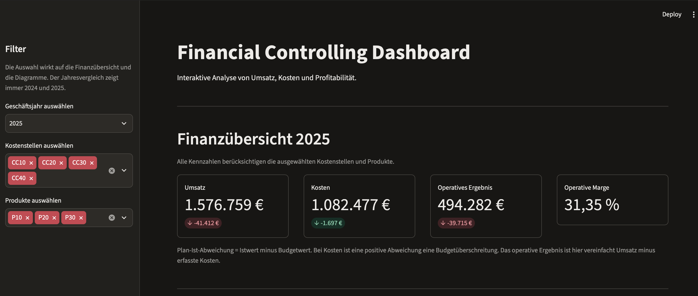
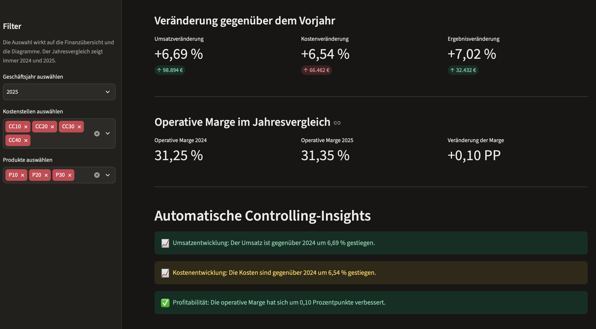

# Financial Performance & Controlling Dashboard

An interactive financial controlling dashboard built with **Python, Streamlit, Pandas, and Plotly**.

This portfolio project demonstrates how financial data can be analyzed, visualized, and transformed into actionable management insights.

The application combines financial KPI monitoring, budget variance analysis, product profitability assessment, and automated controlling insights in an interactive dashboard.

## Dashboard Preview

### 1. Financial Overview

Overview of key financial performance indicators, including revenue, costs, operating profit, operating margin, and budget deviations.



### 2. Monthly Revenue Development

Interactive comparison of actual revenue and budgeted revenue throughout the selected business year.


### 3. Cost Center & Product Profitability Analysis

Identification of cost center budget deviations and comparison of operating profit across products.


### 4. Year-over-Year Comparison

Comparison of financial performance between 2024 and 2025, including revenue, costs, operating profit, and growth rates.


### 5. Automated Controlling Insights

Rule-based interpretation of financial performance, highlighting revenue growth, cost developments, and changes in operating margins.



---

## Project Overview

The Financial Performance & Controlling Dashboard is a Python-based business intelligence application designed to support financial analysis and management decision-making.

The dashboard enables users to:

- Monitor financial performance through interactive KPI cards.
- Compare actual financial results against budget targets.
- Identify budget overruns and cost savings.
- Evaluate product profitability.
- Analyze financial developments across business years.
- Generate automated insights based on financial KPIs.

Users can filter the dashboard by business year, cost center, and product.

The project demonstrates the practical application of financial controlling, data analytics, and business intelligence concepts.

## Key Features

### Financial KPI Monitoring

The dashboard calculates and displays four central financial indicators:

- **Revenue:** Total revenue generated during the selected period.
- **Costs:** Total costs incurred during the selected period.
- **Operating Profit:** Revenue minus recorded costs.
- **Operating Margin:** Operating profit expressed as a percentage of revenue.

### Budget vs. Actual Analysis

Comparison of planned and actual financial performance:

- Revenue variance
- Cost variance
- Operating profit variance
- Monthly revenue development
- Identification of budget deviations

### Cost Center Analysis

The dashboard evaluates cost performance across four cost centers.

Features include:

- Comparison of actual costs against budgeted costs
- Identification of budget overruns
- Visualization of cost savings
- Interactive cost center filtering

### Product Profitability Analysis

Analysis of operating profit across three products.

The dashboard provides:

- Product-level revenue and cost aggregation
- Operating profit calculation by product
- Profitability comparison
- Interactive product filtering

### Year-over-Year Analysis

Financial performance comparison between 2024 and 2025.

The analysis includes:

- Revenue growth
- Cost development
- Operating profit growth
- Operating margin comparison
- Percentage and absolute changes

### Automated Controlling Insights

The application automatically evaluates selected financial indicators and generates rule-based management insights.

Examples include:

- Identification of revenue growth or decline
- Detection of increasing or decreasing costs
- Evaluation of operating margin improvements
- Identification of deteriorating profitability

These insights automatically adjust to the selected cost centers and products.

### Data Quality & Validation

The dashboard includes several automated data validation mechanisms:

- Missing value detection
- Duplicate record detection
- Validation of financial data types
- Consistency checks between actual and budget datasets
- Detection of negative financial values
- Calculation consistency checks

These mechanisms support data reliability and help identify potential inconsistencies before financial analysis.

## Technology Stack

| Technology | Purpose |
|---|---|
| Python | Financial calculations and application logic |
| Pandas | Data processing, filtering, and aggregation |
| Streamlit | Interactive web dashboard |
| Plotly | Interactive financial visualizations |
| Git | Version control |
| GitHub | Source code hosting and documentation |

## Dataset

All financial data used in this project is **synthetic**.

The dataset is generated reproducibly using `scripts/generate_data.py` with a fixed random seed.

It includes:

- Financial records for 2024 and 2025
- Four cost centers
- Three products
- Monthly actual and budget figures
- Revenue and cost information

### Data Files

| File | Description |
|---|---|
| `actuals.csv` | Actual revenue and costs |
| `budget.csv` | Planned revenue and costs |
| `cost_centers.csv` | Cost center reference data |
| `products.csv` | Product reference data |

Each financial record represents a combination of month, cost center, and product.

## Financial Calculations

### Operating Profit

Operating Profit = Revenue - Costs

### Operating Margin

Operating Margin = (Operating Profit / Revenue) × 100

### Revenue Variance

Revenue Variance = Actual Revenue - Budget Revenue

### Cost Variance

Cost Variance = Actual Costs - Budget Costs

### Operating Profit Variance

Operating Profit Variance = Actual Operating Profit - Budget Operating Profit

### Year-over-Year Growth

Growth Rate = ((Current Year - Previous Year) / Previous Year) × 100

**Note:** Operating profit is calculated using the revenue and costs included in the synthetic dataset. It represents a simplified financial performance measure and should not be interpreted as formally reported EBIT.

## Example Financial Insights

Based on the complete synthetic dataset for 2025:

| Financial KPI | Result |
|---|---:|
| Revenue | €1,576,759 |
| Costs | €1,082,477 |
| Operating Profit | €494,282 |
| Operating Margin | 31.35% |
| Revenue Growth vs. 2024 | +6.69% |
| Cost Growth vs. 2024 | +6.54% |
| Operating Profit Growth vs. 2024 | +7.02% |

### Management Interpretation

The synthetic financial data indicates positive year-over-year performance in 2025.

Revenue increased by approximately 6.69%, while operating profit increased by approximately 7.02%.

However, actual revenue remained approximately €41,412 below budget, resulting in an operating profit shortfall of approximately €39,715 compared with planned performance.

This illustrates why financial controlling requires both historical performance comparisons and budget variance analysis.

These results are illustrative and do not represent the performance of a real company.

## Project Structure

```text
financial-controlling-starter/
├── app.py
├── README.md
├── requirements.txt
├── .gitignore
├── data/
│   ├── actuals.csv
│   ├── budget.csv
│   ├── cost_centers.csv
│   └── products.csv
├── scripts/
│   ├── generate_data.py
│   └── financial_analysis.py
├── outputs/
└── screenshots/
    ├── 01-financial-overview.png
    ├── 02-monthly-revenue.png
    ├── 03-cost-center-product-analysis.png
    ├── 04-year-over-year.png
    └── 05-controlling-insights.png
```

## How to Run the Dashboard

### 1. Clone the Repository

```bash
git clone https://github.com/tamerazizdemiral/financial-controlling-powerbi.git
```

### 2. Navigate to the Project Directory

```bash
cd financial-controlling-powerbi
```

### 3. Create a Virtual Environment

```bash
python3 -m venv .venv
```

### 4. Activate the Virtual Environment

On macOS or Linux:

```bash
source .venv/bin/activate
```

On Windows:

```bash
.venv\Scripts\activate
```

### 5. Install Dependencies

```bash
pip install -r requirements.txt
```

### 6. Launch the Dashboard

```bash
streamlit run app.py
```

The dashboard will open in your web browser.

## Business Value

This project demonstrates how financial data analytics can support business decision-making through:

- **Financial Transparency:** Clear monitoring of revenue, costs, and profitability.
- **Budget Control:** Identification of deviations between planned and actual results.
- **Cost Management:** Evaluation of cost center performance.
- **Profitability Analysis:** Assessment of operating profit across products.
- **Performance Monitoring:** Comparison of financial results over time.
- **Automated Insights:** Rule-based interpretation of financial developments.

The dashboard combines technical implementation with business-oriented financial analysis.

## Future Improvements

Potential extensions include:

- Integration of external financial data sources
- Financial forecasting and scenario analysis
- Additional controlling KPIs
- Automated reporting and data export
- More advanced variance analysis
- Online deployment using Streamlit Community Cloud

## Data Privacy

This project uses exclusively artificially generated financial data for educational and portfolio purposes.

No confidential company, customer, or internship information is included.

## Project Purpose

This project was developed as an independent portfolio project to demonstrate practical skills in:

- Financial Controlling
- Business Intelligence
- Data Analytics
- Python Programming
- Financial Data Visualization
- Data-Driven Decision-Making
