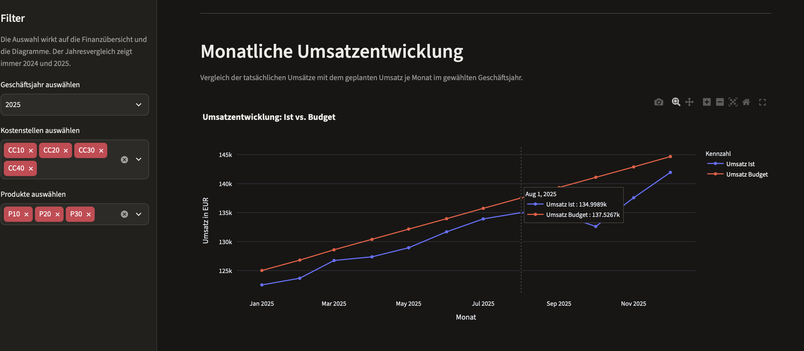
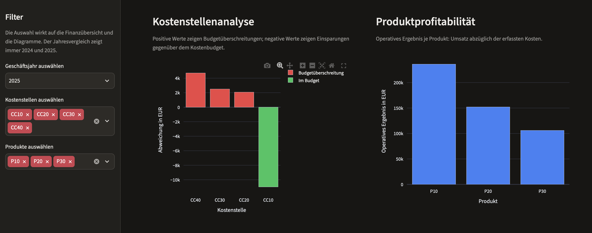
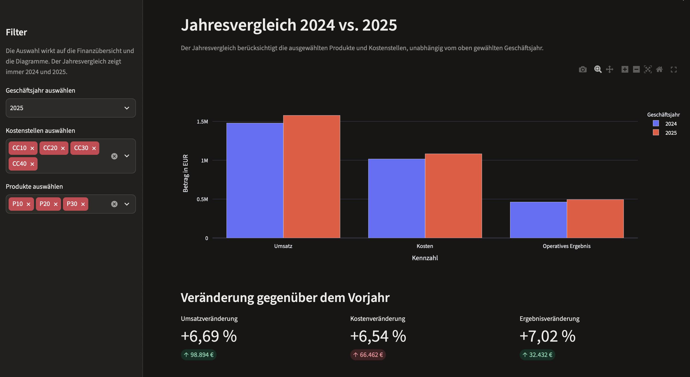

# Financial Controlling Dashboard

**Interactive financial performance analysis using Python, Streamlit, Pandas and Plotly.**

A self-developed portfolio project combining financial controlling, data analytics and interactive business intelligence.

The dashboard analyzes revenue, costs, operating profitability and budget deviations using synthetic financial data for 2024 and 2025.

## Dashboard Preview

### Financial Overview

Key financial indicators including revenue, costs, operating profit, operating margin and budget deviations.


### Monthly Revenue Analysis

Comparison of actual and budgeted revenue throughout the selected financial year.



### Cost Center & Product Profitability

Analysis of cost center budget deviations and operating profit by product.



### Year-over-Year Performance

Comparison of revenue, costs, operating profit and operating margins between 2024 and 2025.



### Automated Controlling Insights

Rule-based financial interpretations highlighting revenue trends, cost developments and changes in profitability.


---

## Project Objectives

The objective of this project is to demonstrate how financial data can be processed and transformed into relevant information for management decision-making.

The dashboard addresses five central controlling questions:

1. How is the company performing financially?
2. Are actual results meeting budget expectations?
3. Which cost centers exceed their planned budgets?
4. How profitable are individual products?
5. How has financial performance developed compared with the previous year?

## Key Features

### Financial Performance Monitoring

Interactive KPI cards displaying:

- Revenue
- Costs
- Operating Profit
- Operating Margin

### Budget vs. Actual Analysis

Comparison of planned and actual financial performance, including:

- Revenue variance
- Cost variance
- Operating profit variance
- Monthly actual vs. budget revenue development

**Variance interpretation:**

All absolute variances are calculated as Actual minus Budget.

- **Revenue variance:** Positive values indicate revenue above budget and are generally favorable.
- **Cost variance:** Positive values indicate costs above budget and are generally unfavorable.
- **Operating profit variance:** Positive values indicate operating profit above budget and are generally favorable.

This distinction is reflected in the dashboard's KPI indicators and cost center analysis.

### Cost Center Analysis

- Comparison of actual and budgeted costs
- Identification of budget overruns and savings
- Visualization of cost variances by cost center

### Product Profitability

- Aggregation of revenue and costs by product
- Calculation of operating profit and operating margin
- Comparison of product profitability

### Year-over-Year Analysis

- Revenue growth
- Cost development
- Operating profit growth
- Operating margin changes

The year-over-year comparison covers 2024 and 2025 and responds to the selected cost centers and products.

### Rule-Based Controlling Insights

The dashboard generates automated interpretations based on predefined financial rules.

These include:

- Revenue growth or decline
- Increasing or decreasing costs
- Improving or deteriorating operating margins

**The insights are rule-based and do not use artificial intelligence or machine learning.**

### Data Validation

Automated checks include:

- Missing values and duplicate records
- Invalid financial values
- Duplicate combinations of month, cost center and product
- Consistency between actual and budget datasets
- Detection of negative financial values
- Mathematical consistency of financial calculations

## Example Financial Results

The following results are based on the complete synthetic dataset for 2025, without additional cost center or product filters.

| Financial KPI | 2025 Result |
|---|---:|
| Revenue | €1,576,759 |
| Costs | €1,082,477 |
| Operating Profit | €494,282 |
| Operating Margin | 31.35% |
| Revenue Growth vs. 2024 | +6.69% |
| Cost Growth vs. 2024 | +6.54% |
| Operating Profit Growth vs. 2024 | +7.02% |

### Management Interpretation

Financial performance improved compared with the previous year.

Revenue increased by 6.69%, while operating profit grew by 7.02%. The operating margin also improved slightly.

However, the budget comparison reveals a different perspective:

- Actual revenue was approximately €41,412 below budget.
- Actual costs were approximately €1,697 below budget.
- Operating profit was approximately €39,715 below budget.

Although the company achieved year-over-year growth, it did not meet its planned operating profit target.

**Key takeaway:** Positive historical growth does not necessarily imply satisfactory budget performance. Both perspectives are essential for effective financial controlling.

All results are illustrative and based exclusively on synthetic data.

## Technology Stack

| Technology | Application |
|---|---|
| Python | Application logic and financial calculations |
| Pandas | Data processing, filtering and aggregation |
| Streamlit | Interactive dashboard interface |
| Plotly | Interactive financial visualizations |
| Git | Version control |
| GitHub | Project hosting and documentation |

## Data Model

The dashboard uses CSV-based financial datasets.

The data covers:

- Two financial years: 2024 and 2025
- Four cost centers
- Three products
- Monthly financial records
- Actual and budgeted revenue and costs

### Data Files

| File | Description |
|---|---|
| `actuals.csv` | Actual revenue and costs |
| `budget.csv` | Budgeted revenue and costs |
| `cost_centers.csv` | Cost center reference data |
| `products.csv` | Product reference data |

Each financial record represents one combination of month, cost center and product.

Actual and budget datasets are validated against matching combinations of these dimensions.

All data is generated synthetically using `scripts/generate_data.py` with a fixed random seed.

## Financial Calculations

### Operating Profit

Operating Profit = Revenue - Costs

### Operating Margin

Operating Margin = (Operating Profit / Revenue) × 100

### Revenue Variance

Revenue Variance = Actual Revenue - Budget Revenue

### Cost Variance

Cost Variance = Actual Costs - Budget Costs

### Operating Profit Variance

Operating Profit Variance = Actual Operating Profit - Budget Operating Profit

### Year-over-Year Growth

Growth Rate = ((Current Value - Previous Value) / Previous Value) × 100

**Accounting limitation:** Operating profit is calculated using the revenue and cost categories available in the synthetic dataset. It is a simplified profitability measure and should not be interpreted as formally reported EBIT.

## Project Structure

```text
financial-controlling-dashboard/
├── app.py
├── README.md
├── requirements.txt
├── .gitignore
├── data/
│   ├── actuals.csv
│   ├── budget.csv
│   ├── cost_centers.csv
│   └── products.csv
├── scripts/
│   ├── generate_data.py
│   └── financial_analysis.py
├── outputs/
└── screenshots/
    ├── 01-financial-overview.png
    ├── 02-monthly-revenue.png
    ├── 03-cost-center-product-analysis.png
    ├── 04-year-over-year.png
    └── 05-controlling-insights.png
```

## Installation and Usage

### 1. Clone the repository

```bash
git clone https://github.com/tamerazizdemiral/financial-controlling-dashboard.git
```

### 2. Navigate to the project

```bash
cd financial-controlling-dashboard
```

### 3. Create a virtual environment

```bash
python3 -m venv .venv
```

### 4. Activate the environment

macOS / Linux:

```bash
source .venv/bin/activate
```

Windows:

```powershell
.venv\Scripts\Activate.ps1
```

### 5. Install dependencies

```bash
pip install -r requirements.txt
```

### 6. Run the dashboard

```bash
streamlit run app.py
```

The application will launch locally in your web browser.

## Limitations and Future Improvements

The project currently uses synthetic financial data and a CSV-based data structure.

Potential future extensions include:

- Integration with financial databases or ERP systems
- Additional financial KPIs
- Forecasting and scenario analysis
- Automated reporting and export functionality
- More detailed variance analysis
- Automated software testing

## Data Privacy

This project uses exclusively synthetic financial data.

No confidential company, customer or internship information is included.

## Project Purpose

This independent portfolio project demonstrates the practical application of:

- Financial Controlling
- Business Intelligence
- Financial Data Analysis
- Python Programming
- Data Visualization
- Data Quality Validation
- Data-Driven Decision-Making
